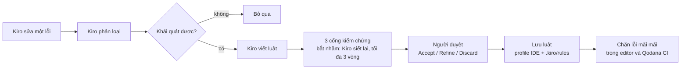

# Biến mỗi lỗi Kiro sửa thành luật vĩnh viễn

Thiết kế ý tưởng, ngày 07/11/2026.

## Tóm tắt

Khi Kiro sửa một lỗi có tính lặp lại, plugin Kiro GUI yêu cầu Kiro viết thêm một luật kiểm tra bắt đúng mẫu lỗi đó. Luật phải qua 3 cổng kiểm chứng tự động, được người duyệt, rồi lưu vào profile inspection của project để cả team và CI cùng dùng.

- **Vấn đề:** AI sửa lỗi từng chỗ một. Cùng loại lỗi quay lại ở chỗ khác, mỗi lần lại tốn credits và thời gian review.
- **Ý tưởng:** biến phán đoán của AI thành công cụ tất định. Sửa một lần, chặn mãi mãi, không tốn thêm credits.
- **Giá trị:** tìm ra các lỗi cùng loại đang nằm sẵn trong code ngay lúc tạo luật; chặn lỗi trước khi review; tri thức của team tích luỹ thành luật thay vì nằm trong lịch sử chat.

## Bối cảnh và cơ sở kỹ thuật

Phần lớn nền móng đã có trong plugin hoặc đã thử thành công với kiro-cli 3.1.0 ngày 07/11/2026; không cần thay đổi gì ở kiro-cli. Chỉ còn phần gọi Structural Search bằng code là chưa kiểm chứng.

| Điều kiện | Trạng thái | Ghi chú |
| --- | --- | --- |
| Plugin có bản trước và sau của mỗi file Kiro sửa | Có sẵn | Kiro ghi file qua `fs/write_text_file` của plugin; plugin đã hiện diff trước khi áp dụng |
| Plugin gửi prompt cho Kiro và biết khi lượt kết thúc | Có sẵn | `session/prompt` trả về `stopReason` |
| Plugin cấp công cụ MCP riêng cho Kiro | Đã thử thành công | `mcpServers` trong `session/new`; kiro-cli hỗ trợ stdio, HTTP, SSE |
| Plugin chạy lệnh thay Kiro | Đã thử thành công | Khai báo `terminal: true` khi `initialize` |
| Gọi Structural Search bằng code, ghi mục `SSBasedInspection` vào profile | Chưa kiểm chứng | Thử trên IDE 2025.1 ở giai đoạn 0 |

## Luồng tổng thể

Mỗi luật đi qua đúng một đường: Kiro đề xuất, plugin kiểm chứng, người duyệt quyết định.



Ở bước phân loại, nếu IntelliJ đã có inspection cho lỗi này thì Kiro đề xuất bật nó thay vì viết luật mới. Refine ở bước duyệt đưa luật quay lại cho Kiro siết tiếp.

## Các dạng luật

Mặc định là inspection Structural Search, vì nó chạy ngay trong editor, có quick fix và được Qodana kiểm tra trên CI. Trước khi viết luật mới, Kiro kiểm tra xem IntelliJ đã có inspection cho lỗi này chưa.

| Dạng | Dùng khi | Chạy ở đâu | Quick fix |
| --- | --- | --- | --- |
| Bật inspection có sẵn | IntelliJ đã có inspection cho lỗi này nhưng đang tắt | Editor, Qodana CI | Theo inspection đó |
| Structural Search inspection (mặc định) | Mẫu code cụ thể trong Java, Kotlin, JS/TS, XML | Editor, Qodana CI | Có, nếu kèm template thay thế |
| Test ArchUnit | Luật kiến trúc: phụ thuộc giữa các tầng, package | Unit test, mọi CI | Không |
| Luật Semgrep (tuỳ chọn) | CI không chạy được Qodana | CI | Có (autofix) |

**Lỗi khái quát được**, ví dụ: so sánh `Long == Long`, `new BigDecimal(double)`, `SimpleDateFormat` để static, `@Transactional` trên method private, `Optional.get()` không kiểm tra, quên đóng stream, controller gọi thẳng repository.

**Không khái quát được:** lỗi logic nghiệp vụ riêng, ví dụ sai công thức tính phí. Những lỗi này được bỏ qua.

Ví dụ một luật Structural Search kèm quick fix:

```
Tìm:        $a$ == $b$
Ràng buộc:  kiểu của $a$ và $b$ là java.lang.Long
Thay bằng:  java.util.Objects.equals($a$, $b$)
```

## Ba cổng kiểm chứng

Một luật chỉ được đưa cho người duyệt khi tự chứng minh được nó đúng. Các cổng chạy trên máy, không tốn credits; chỉ các vòng Kiro siết lại luật mới tốn credits.

Trước các cổng, plugin kiểm tra cú pháp của template. Template sai thì thông báo lỗi được trả lại để Kiro sửa.

1. **Bắt được bản trước.** Chạy luật trên nội dung file trước khi Kiro sửa. Phải có ít nhất một kết quả nằm đúng vùng đã sửa.
2. **Không bắt bản sau.** Chạy luật trên nội dung sau khi sửa. Vùng đã sửa phải không còn kết quả nào.
3. **Quét toàn project.** Hiện mọi kết quả khác trong code.
    - Không có kết quả nào: ổn.
    - Có kết quả: người dùng đánh dấu từng chỗ là lỗi thật hay bắt nhầm. Lỗi thật là phát hiện thêm, có thể sửa luôn bằng quick fix.
    - Bắt nhầm vượt ngưỡng cấu hình: Kiro siết ràng buộc của luật, tối đa 3 vòng. Sau 3 vòng vẫn nhiễu thì bỏ luật.

Cổng 3 cũng đo thời gian quét, để cảnh báo những luật làm IDE chậm trên project lớn.

## Lưu trữ, chia sẻ và CI

Luật nằm trong file của repo nên cả team có ngay khi pull, và CI kiểm tra cùng bộ luật đó.

| Nơi lưu | Nội dung | Ai dùng |
| --- | --- | --- |
| `.idea/inspectionProfiles/Project_Default.xml` | Mục `SSBasedInspection`: template tìm, template thay thế, ràng buộc, mức độ | IntelliJ của mọi người, Qodana trên CI |
| `src/test/.../archrules/` | Test ArchUnit cho luật kiến trúc | Unit test, mọi CI |
| `.kiro/rules/<id>.md` | Hồ sơ luật: lỗi gốc, ví dụ trước/sau, phiên Kiro tạo ra, người duyệt, ngày tạo, số lần bắt, số lần bị suppress | Team, mục Rules trong Library của plugin |
| `.kiro/steering/rules.md` (tuỳ chọn) | Mỗi luật một dòng ngắn | Kiro, để không viết ra mẫu lỗi đó nữa |

Nếu CI dùng SonarQube thay vì Qodana: luật tuỳ biến của Sonar phải viết thành plugin Java, khó sinh tự động. Khi đó dùng ArchUnit hoặc Semgrep cho phần CI, còn inspection vẫn chạy trong editor.

File steering phải giữ ngắn, vì nó vào context của mọi lượt và tốn token.

## Kiến trúc trong plugin

Tính năng gồm năm thành phần mới trong package `rules`, dùng lại kết nối ACP, `FileAccess` và Library đã có.

| Thành phần | Vai trò | Dùng lại |
| --- | --- | --- |
| `rules/RuleCapture.kt` | Ghi lại cặp trước/sau mỗi lần Kiro ghi file; hiện gợi ý "Biến thành luật" khi lượt có sửa file | `FileAccess`, `KiroChatPanel` |
| `rules/RuleValidator.kt` | Kiểm tra cú pháp, chạy 3 cổng bằng Structural Search trên bản trước, bản sau và cả project | API Structural Search của IntelliJ |
| `rules/InspectionProfileWriter.kt` | Ghi mục `SSBasedInspection` vào profile của project, theo thứ tự tên ổn định | API inspection profile |
| `rules/RuleStore.kt` | Đọc và ghi `.kiro/rules/*.md`, thống kê số lần bắt và suppress | `KiroResources`, Library |
| `ui/RuleReviewDialog.kt` | Xem luật, kết quả 3 cổng, danh sách chỗ khác trong code; Accept / Refine / Discard | Diff viewer của IDE |

Giai đoạn sau, plugin cấp cho Kiro công cụ MCP `validate_rule`, để Kiro tự thử template qua 3 cổng trước khi đề xuất. Cách cắm MCP qua `session/new` đã thử thành công.

## Trải nghiệm người dùng

Người dùng chỉ bấm hai lần: một lần để tạo luật, một lần để duyệt. Không có gì chạy ngầm tốn credits.

1. Kiro sửa xong một lỗi. Dưới câu trả lời hiện gợi ý **Biến thành luật**, chỉ khi lượt đó có sửa file.
2. Bấm gợi ý. Plugin gửi diff cho Kiro. Kiro trả lời: lỗi có khái quát được không, dạng luật, template, giải thích và mức độ đề xuất.
3. Plugin chạy 3 cổng rồi mở hộp thoại duyệt luật. Hộp thoại hiện:
    - luật và giải thích;
    - bản trước và bản sau, đánh dấu chỗ luật bắt;
    - danh sách các chỗ khác trong project, mở được từng chỗ;
    - mức độ: weak warning, warning hoặc error.
4. Chọn **Accept**, **Refine** (Kiro siết lại) hoặc **Discard**.
5. Sau khi Accept: plugin ghi profile và hồ sơ luật. Tuỳ chọn **Sửa tất cả** bằng quick fix (không tốn credits), và tạo commit `rule: <tên luật>`.

## KPI

Con số thuyết phục nhất là số lỗi tiềm ẩn tìm thấy ngay lúc tạo luật. Mọi số liệu đều đếm trên máy hoặc từ báo cáo CI; plugin không gửi số liệu đi đâu.

| KPI | Cách đo | Nguồn |
| --- | --- | --- |
| Lỗi tiềm ẩn tìm thấy lúc tạo luật | Kết quả cổng 3 được đánh dấu là lỗi thật | Plugin |
| Vi phạm bị chặn về sau | Cảnh báo trong editor và trong báo cáo Qodana | Plugin, CI |
| Số luật được chấp nhận mỗi tháng | Đếm hồ sơ trong `.kiro/rules` | Plugin |
| Tỷ lệ chấp nhận | Luật Accept chia cho luật đề xuất | Plugin |
| Credits trên mỗi luật | Tổng credits các lượt tạo và siết luật | Sự kiện `turn_completion` của kiro-cli |
| Tỷ lệ bắt nhầm | Số lần suppress chia cho số cảnh báo | Chú thích `noinspection` trong mã nguồn |

## Rủi ro và cách giảm

Rủi ro lớn nhất là nhiễu: luật bắt nhầm nhiều thì team sẽ phớt lờ mọi cảnh báo.

| Rủi ro | Ảnh hưởng | Cách giảm |
| --- | --- | --- |
| Quá nhiều luật, bắt nhầm | Team phớt lờ cảnh báo | 3 cổng; mặc định weak warning; người duyệt bắt buộc; tự đề xuất gỡ luật bị suppress nhiều |
| Model viết sai template Structural Search | Luật hỏng hoặc không bắt gì | Kiểm tra cú pháp, trả lỗi cho Kiro; ví dụ mẫu trong prompt; công cụ `validate_rule` ở giai đoạn sau |
| API Structural Search và định dạng profile chưa kiểm chứng | Chậm tiến độ | Làm thử kỹ thuật ở giai đoạn 0, trước mọi phần khác |
| Xung đột merge trên file profile XML | Mất luật khi merge | Ghi theo thứ tự tên ổn định, mỗi luật một khối |
| Nhiều inspection Structural Search trên project lớn | IDE chậm | Đo thời gian quét ở cổng 3, cảnh báo luật chậm, giới hạn phạm vi |
| Luật sai với quy ước của team | Chặn code đúng | Người duyệt trước khi commit; luật mới không để mức error |
| Diff được gửi cho Kiro | Mã nguồn rời máy | Giống chat Kiro hiện tại; không gửi thêm gì ngoài diff của lượt đó |

## MVP và lộ trình

MVP chỉ làm Java, inspection Structural Search hoặc bật inspection có sẵn, kích hoạt bằng tay, đủ 3 cổng và hộp thoại duyệt.

**Kịch bản demo:** Kiro sửa một chỗ so sánh `Long ==`. Bấm "Biến thành luật". Plugin báo tìm thấy thêm các chỗ cùng lỗi trong project. Bấm "Sửa tất cả", quick fix xử lý hết mà không tốn credits.

1. **Giai đoạn 0, thử kỹ thuật:** gọi Structural Search bằng code trên IDE 2025.1; đọc và ghi mục `SSBasedInspection`. Đạt khi cả 3 cổng chạy được trên ví dụ `Long ==`.
2. **Giai đoạn 1, MVP:** `RuleCapture`, `RuleValidator`, `InspectionProfileWriter`, `RuleStore`, hộp thoại duyệt, gợi ý trong chat.
3. **Giai đoạn 2:** test ArchUnit, công cụ MCP `validate_rule`, mục Rules trong Library, "Sửa tất cả" bằng quick fix.
4. **Giai đoạn 3, thêm nguồn kích hoạt:** commit sửa lỗi của người, comment review trên PR, các nhóm lỗi trong Xưởng migration.
5. **Giai đoạn 4:** báo cáo KPI, tự đề xuất gỡ luật bị suppress nhiều.

`RuleValidator` cũng là lõi của Xưởng migration, nên làm ý tưởng này trước giúp ý tưởng migration có sẵn phần then chốt.

## Trạng thái triển khai

Giai đoạn 1 đã có code, chưa build và chưa chạy thử trong IDE.

- Kiro tự ghi file ra đĩa, nên bản trước được bắt theo thứ tự: lúc xin quyền sửa file, lúc tool sửa file báo đường dẫn, rồi Local History tại thời điểm bắt đầu lượt.
- Gợi ý **Turn into rule** hiện dưới câu trả lời của mọi lượt có sửa file. Cuộc trao đổi về luật diễn ra ngay trong chat, nên người dùng thấy Kiro đề xuất gì.
- Kiro trả luật dưới dạng JSON: Structural Search kèm ràng buộc kiểu, hoặc tên một inspection có sẵn.
- Ba cổng chạy trên bản sao PSI của file trước và sau khi sửa, rồi quét toàn project, tối đa 300 kết quả.
- Lỗi cú pháp hoặc trượt cổng 1, cổng 2 thì gửi lại cho Kiro. Tổng cộng tối đa 3 vòng, tính chung với các lần Refine.
- Accept ghi vào profile hiện tại, cảnh báo nếu profile nằm trong IDE thay vì trong project. Sau đó ghi `.kiro/rules/<id>.md`, thêm một dòng vào `.kiro/steering/rules.md` (tuỳ chọn), và tuỳ chọn sửa các chỗ đánh dấu là lỗi thật bằng template thay thế.

| File | Vai trò |
| --- | --- |
| `rules/RuleCapture.kt` | Bản trước và sau của mỗi lượt |
| `rules/LineDiff.kt` | Diff gửi Kiro, các dòng đã sửa cho cổng 1 và 2 |
| `rules/RuleProposal.kt` | Đọc JSON của Kiro, các prompt |
| `rules/RuleValidator.kt` | Dựng cấu hình Structural Search, kiểm tra cú pháp, 3 cổng, sửa hàng loạt |
| `rules/InspectionProfileWriter.kt` | Ghi vào inspection profile |
| `rules/RuleStore.kt` | Hồ sơ luật và steering |
| `rules/RuleFlow.kt` | Điều phối: Kiro, các cổng, hộp thoại duyệt, lưu |
| `ui/RuleReviewDialog.kt` | Hộp thoại Accept / Refine / Discard |

Chưa làm: mục Rules trong Library, công cụ MCP `validate_rule`, ArchUnit, thống kê số lần suppress.

## Câu hỏi mở

- [ ] Ngôn ngữ chính của các dự án là Java hay Kotlin? Mức hỗ trợ Structural Search cho Kotlin cần kiểm tra riêng.
- [ ] CI đang dùng Qodana hay SonarQube?
- [ ] Ai được duyệt luật mới: tech lead hay bất kỳ ai trong team?
- [ ] Mức mặc định của luật mới là weak warning hay warning?
- [ ] Có cho phép luật ở mức error chặn build trên CI không?
